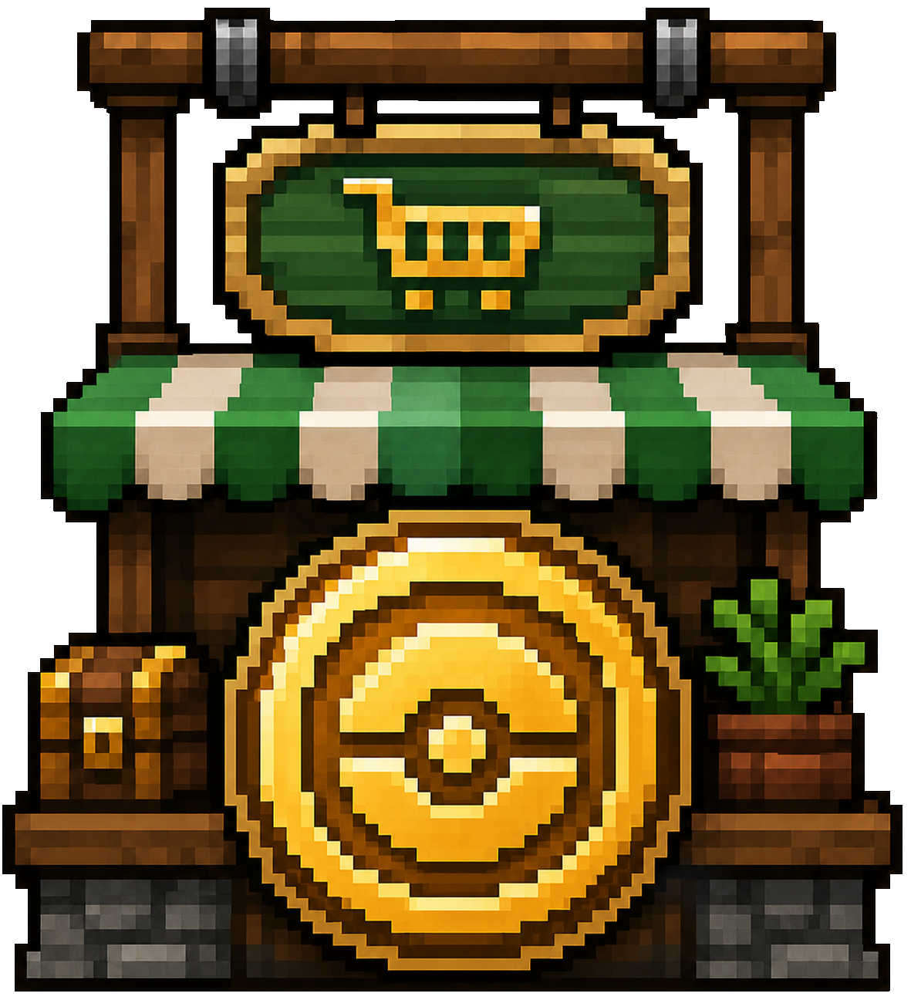

# CobbleDollars Command Shops

<p align="center">
  
</p>

Server-side NeoForge addon for CobbleDollars on Minecraft `1.21.1`.

Version `1.0.3` requires CobbleDollars `2.0.0+Beta-6.1+1.21.1` or newer. Its commands,
configuration files, player stock, and optional client installation work as before.
Clients with the optional addon installed should also update it to `1.0.3`.
For CobbleDollars Beta 5.1, use addon version `1.0.2`.

This mod adds command-driven CobbleDollars shops with:
- persistent per-player stock
- configurable global or per-shop banks
- exact matching through `match.include` / `match.exclude` with `item`, `stack`, `tag`, and `mod`
- conditional visibility and access rules
- runtime shop visibility toggles through commands
- optional purchase bonuses when buying enough bundles in one transaction
- structured audit logs for buys, sells, and visibility changes
- hot config reload with `/cdshops reload`
- configurable server-only player feedback through `feedback.json`
- optional client-side UI enhancements when the same jar is installed on the client
- built-in English and French localized feedback

It does not replace CobbleDollars, replace CobbleDollars NPCs, or move gameplay authority to the client. It only takes over sessions opened through this addon.

## Commands

Public commands:

- `/cdshops open <shop>`
- `/cdshops list`
- `/cdshops visibility list`

Admin commands (`permission level 2`):

- `/cdshops admin` (requires this addon on the administrator's client)
- `/cdshops open <shop> <targets>`
- `/cdshops reload`
- `/cdshops restock <shop> all <players>`
- `/cdshops restock <shop> offer <offer> <players>`
- `/cdshops stock <shop> <player>`
- `/cdshops visibility <shop> status`
- `/cdshops visibility <shop> enable`
- `/cdshops visibility <shop> disable [message]`
- `/cdshops where`
- `/cdshops stats summary [window]`
- `/cdshops stats top <shops|offers|players|items> [window] [limit]`
- `/cdshops stats shop <shop> [window]`
- `/cdshops stats player <player|uuid> [window]`
- `/cdshops stats item <item> [window]`

## Config

Runtime config files are loaded from:

`config/cobbledollarscommandshops/`

On first server start, the mod generates the default config tree:

```text
config/cobbledollarscommandshops/
  CONFIG_GUIDE.md
  audit.json
  feedback.json
  global_bank.json
  shops/
    general_store/
      shop.json
    blacksmith/
      shop.json
    explorer/
      shop.json
    syntax_showcase/
      shop.json
      bank.json
```

The detailed format reference is available in the repository at:

`docs/CONFIG_GUIDE.md`

The same guide is also generated at runtime in:

`config/cobbledollarscommandshops/CONFIG_GUIDE.md`

The in-game administrator editor opens with `/cdshops admin`. It uses the same
form components, controls, palette, dropdowns and item picker as the Cobblemon
Expeditions administrator interface. It exposes every supported setting in
shops, global/local banks, feedback and audit, including optional settings that
are absent from the files. Nested lists support adding, editing, duplicating,
reordering and removing entries; shops and local banks can also be created or
deleted. Legacy bank formats are editable and can be converted to expose bank
conditions and categories.

Edits remain drafts until **Save**. Saving validates the complete configuration
on the server, checks for changes made since the editor loaded, writes the files
and reloads the active settings and shop sessions. Validation failures preserve
the draft. **Reload** reads the current server files and asks before discarding
unsaved changes. Permission level 2 is checked for all administrative transfers.
Other players can continue using the mod without installing its optional client
layer. The interface is available in English and French.

Component provenance and client verification are documented in
[`docs/ADMIN_UI_COMPONENTS.md`](docs/ADMIN_UI_COMPONENTS.md).

Audit logs are written to:

`logs/cobbledollarscommandshops/audit.jsonl`

## Benchmark Configs

The repository also ships a standalone heavy benchmark pack in:

`bench-configs/heavy_shop_bank/`

It is intentionally kept out of the runtime config tree. Copy it into `config/cobbledollarscommandshops/shops/` only when you want to run manual performance tests.

License terms are in the root `LICENSE` file and are also bundled into the built jar.

## Build

`gradlew build`
